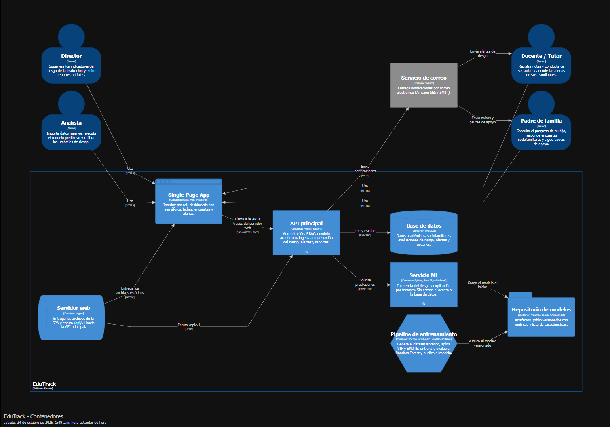

# EduTrack

Plataforma web de seguimiento académico y alerta temprana del riesgo de desaprobación y deserción escolar en estudiantes de secundaria, basada en Machine Learning.

> **Versión 1.0.0** · Ver el [registro de cambios](CHANGELOG.md).

## Descripción

EduTrack centraliza calificaciones, asistencia, conducta y variables sociofamiliares de los estudiantes. Con esos datos, un modelo de clasificación supervisada (Random Forest) estima el riesgo de cada alumno y lo muestra con un semáforo (bajo, moderado y alto). El tutor recibe alertas y recomendaciones que revisa antes de enviarlas a la familia, y el colegio mide al modelo frente a los retiros reales para reentrenarlo con sus propios datos.

Ninguna decisión es automática: el modelo orienta y las personas deciden. Las familias nunca ven niveles de riesgo ni probabilidades.

## Qué hace cada rol

| Rol | Puede |
|---|---|
| **Dirección** | Ver el semáforo del colegio y la ficha de cada estudiante; configurar bimestres, cursos, personal y aulas; cerrar el año; registrar retiros; activar versiones del modelo; atender solicitudes de datos |
| **Docente / tutor** | Registrar asistencia, notas y conducta; atender alertas; revisar y enviar recomendaciones; registrar actas y el seguimiento semanal |
| **Análisis** | Importar datos en dos pasos; ejecutar evaluaciones; ajustar umbrales; medir y reentrenar el modelo |
| **Familia** | Ver el avance de su hijo, las sugerencias aprobadas y responder la encuesta y el seguimiento mensual; ejercer sus derechos sobre los datos |

## Calidad

| Aspecto | Resultado |
|---|---|
| Tests de la API | 261, cobertura 96 % |
| Tests web | 91 de componentes y 13 E2E con Playwright |
| Accesibilidad | Sin problemas graves WCAG 2 A/AA (axe-core) |
| Rendimiento | Todas las pantallas bajo 152 ms (p95) con 560 estudiantes |
| Seguridad | OWASP Top 10 mapeado en [SECURITY.md](SECURITY.md) |
| Privacidad | Ley N.° 29733: aviso, consentimiento y derechos ARCO |

Detalles en [docs/testing.md](docs/testing.md) y [docs/performance.md](docs/performance.md).

## Arquitectura



| Componente | Tecnología |
|---|---|
| Frontend | React · Vite · TypeScript |
| API principal | FastAPI · SQLAlchemy · Alembic |
| Microservicio ML | FastAPI · scikit-learn · imbalanced-learn |
| Base de datos | MySQL 8 |
| Seguridad | JWT · RBAC |
| Infraestructura | Docker Compose · AWS (EC2 / RDS) |

La documentación completa está en [`docs/`](docs/README.md).

## Estructura del repositorio

```
edutrack/
├── apps/web/        # Frontend
├── services/api/    # API principal
├── services/ml/     # Microservicio de Machine Learning
├── docs/            # Arquitectura, ADRs y contratos de API
└── compose.yaml     # Entorno local
```

## Ejecución local

**Requisitos:** Docker Desktop, Node.js 20 y Python 3.12.

```bash
cp .env.example .env
docker compose up --build        # mysql, api, ml, worker y mailpit
```

En otra terminal, el frontend con recarga en caliente:

```bash
cd apps/web
npm install
npm run dev
```

| Servicio | URL |
|---|---|
| Web (desarrollo) | http://localhost:5173 |
| API y documentación | http://localhost:8000/api/docs |
| Servicio ML | http://localhost:8001/docs |
| Bandeja de correos (Mailpit) | http://localhost:8025 |

### Base de datos

Con los contenedores levantados, aplica las migraciones y crea los usuarios de prueba:

```bash
docker compose exec api alembic upgrade head
docker compose exec api python -m scripts.seed_dev
```

| Usuario | Rol |
|---|---|
| director@edutrack.dev | Director |
| docente@edutrack.dev | Docente, tutor de 3° A |
| docente2@edutrack.dev | Docente, tutor de 3° B |
| padre@edutrack.dev | Padre de familia |
| analista@edutrack.dev | Analista |

Todos usan la contraseña `Edutrack123!`. Para un colegio de tamaño real (unos 560 estudiantes), agrega `--size large` al seed.

### Modelo de Machine Learning

El modelo se entrena con un dataset sintético, aplicando VIF para la multicolinealidad, SMOTE solo dentro de los folds de entrenamiento y GridSearch sobre un Random Forest:

```bash
cd services/ml
pip install -r requirements-dev.txt
python -m training.train --export-dataset data/synthetic/dataset.csv
docker compose restart ml
```

El comando muestra F1, ROC-AUC, precisión, recall y la matriz de confusión, y verifica el umbral de calidad (F1 ≥ 0.75 y ROC-AUC > 0.80). El modelo queda en `services/ml/models/`, y su versión y métricas se pueden consultar en `GET http://localhost:8001/v1/model`.

### Tareas programadas

El contenedor `worker` envía los correos automáticos (hora de Lima):

| Tarea | Cuándo | Qué hace |
|---|---|---|
| `checkin-reminders` | Viernes 09:00 | Recuerda al tutor completar el seguimiento semanal |
| `missed-checkins` | Domingo 20:00 | Avisa que la semana cerró sin seguimiento; tras 2 semanas, avisa al director |
| `weekly-attendance` | Sábado 10:00 | Resumen de faltas y tardanzas de la semana a las familias |
| `perfect-attendance` | Día 1, 08:00 | Reconoce la asistencia perfecta del mes anterior |
| `period-grades` | Diario, 07:00 | Notas del bimestre cuando este termina |

Si el estudiante tiene una situación sensible activa, el mensaje se retiene para que el tutor lo revise. Para ejecutar una tarea al instante:

```bash
docker compose exec worker python -m app.worker run weekly-attendance --date 2026-08-08
```

Para levantar también el frontend compilado detrás de Nginx: `docker compose --profile full up --build` y abrir http://localhost:8080.

## Tests

```bash
cd services/api && pip install -r requirements-dev.txt && pytest
cd services/ml  && pip install -r requirements-dev.txt && pytest
cd apps/web     && npm test
cd apps/web     && npm run e2e      # con la aplicación levantada y los datos demo
```

## Datos y privacidad

El modelo inicial se entrena con un **dataset sintético**. En un colegio real, el área de análisis puede reentrenarlo con resultados reales **anonimizados** (sin nombres, códigos ni fechas), y la dirección decide si activa la nueva versión ([ADR-0013](docs/adr/0013-model-lifecycle.md)).

El aviso de privacidad incluido es una **plantilla**: antes de usarlo con un colegio debe completarse con sus datos legales y revisarlo un abogado.

## Flujo de trabajo

Consulta [CONTRIBUTING.md](CONTRIBUTING.md).

## Licencia

[MIT](LICENSE) © 2026 Renzo Alonso Villafuerte Tapia
