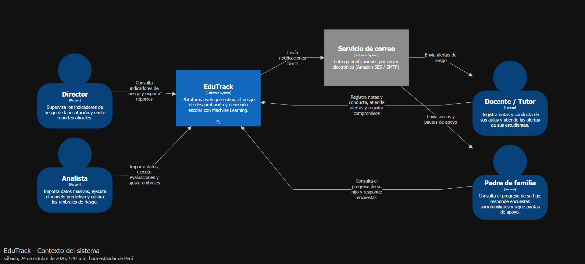
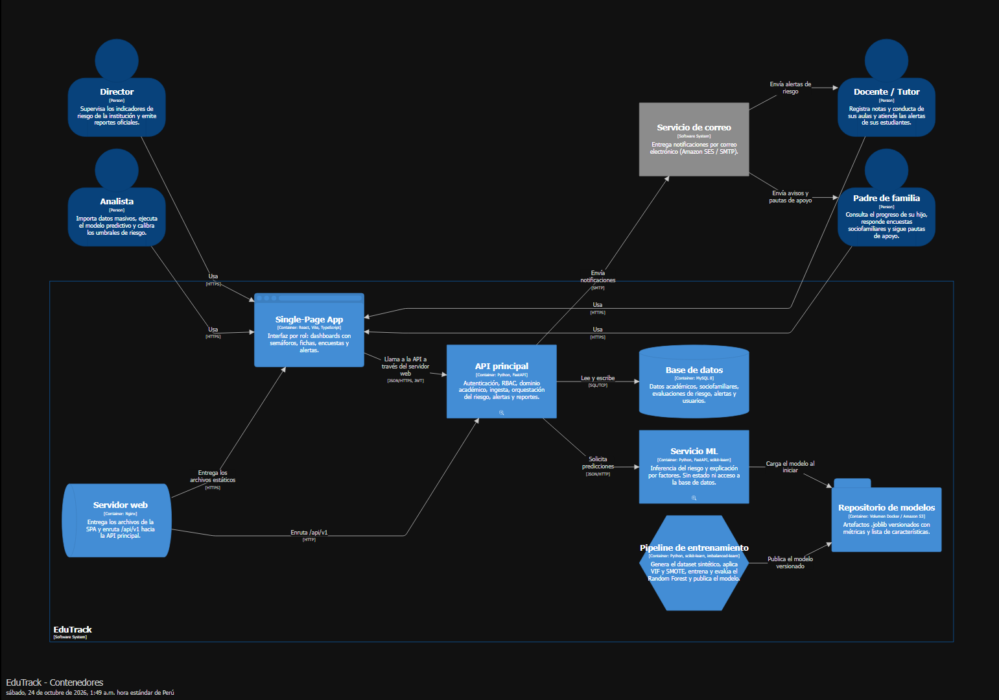
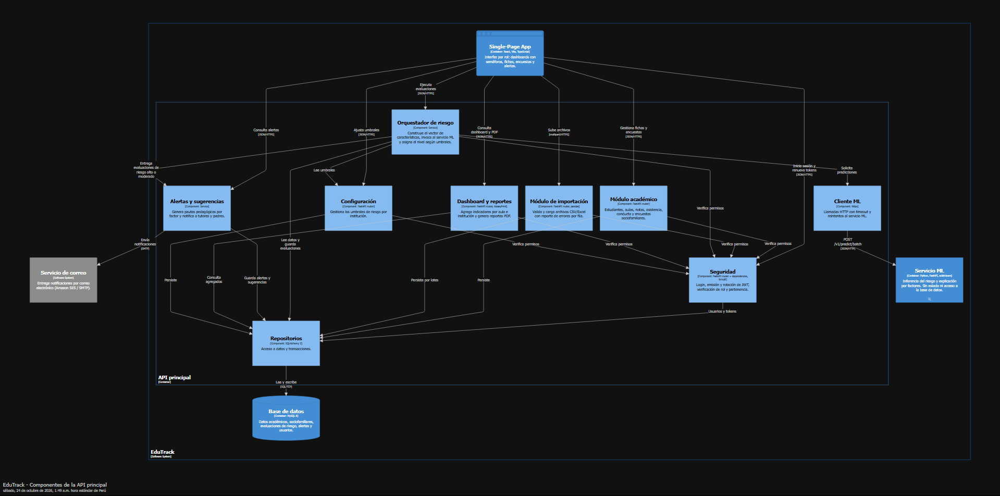
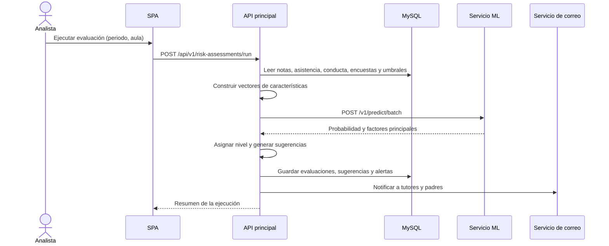

# Arquitectura

Los diagramas siguen el modelo [C4](https://c4model.com/) y se generan con Structurizr a partir de [`workspace.dsl`](workspace.dsl). Ese archivo es la fuente versionada. Además de las vistas incluidas aquí, define los componentes del servicio ML, el flujo de predicción y los despliegues local y en AWS.

## Nivel 1: Contexto del sistema



## Nivel 2: Contenedores



| Contenedor | Responsabilidad |
|---|---|
| Single-Page App | Interfaz por rol, dashboards con semáforos y formularios |
| Servidor web | Entrega la SPA y enruta `/api/v1` hacia la API principal |
| API principal | Autenticación, RBAC, dominio académico, ingesta, alertas y reportes |
| Servicio ML | Inferencia del riesgo y explicación por factores, sin estado |
| Pipeline de entrenamiento | Dataset sintético, VIF, SMOTE, entrenamiento y evaluación del modelo |
| Repositorio de modelos | Artefactos `.joblib` versionados con sus métricas |
| Base de datos | Persistencia relacional en MySQL 8 |

## Nivel 3: Componentes de la API principal



## Flujo de evaluación de riesgo



## Estructura interna de los servicios backend

```
app/
├── api/           # Routers y dependencias (auth, paginación)
├── core/          # Configuración, seguridad, logging
├── domain/        # Entidades y reglas de negocio
├── repositories/  # Acceso a datos (SQLAlchemy)
├── schemas/       # DTOs Pydantic (request/response)
└── services/      # Casos de uso
```

La dependencia va siempre hacia adentro: `api → services → domain`, y `services → repositories`.

## Cómo regenerar los diagramas

1. Pega el contenido de `workspace.dsl` en el editor DSL de Structurizr, o ejecuta Structurizr Lite en Docker apuntando a esta carpeta.
2. Exporta cada vista como PNG con el nombre de la vista y reemplázala en `images/`.
