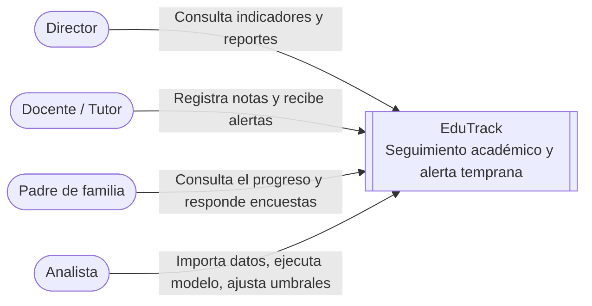
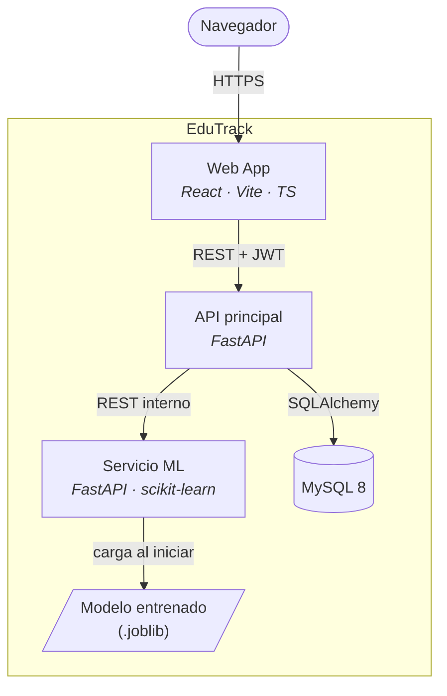
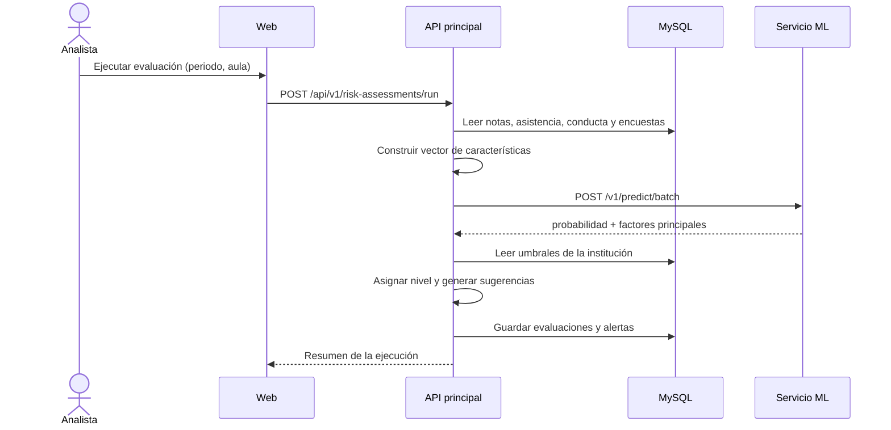

# Arquitectura

## Contexto del sistema



## Contenedores



| Contenedor | Responsabilidad |
|---|---|
| Web App | Interfaz por rol, dashboards con semáforos, formularios |
| API principal | Autenticación, RBAC, dominio académico, ingesta, alertas, reportes |
| Servicio ML | Inferencia del riesgo y explicación por factores |
| MySQL | Persistencia relacional |

## Flujo de evaluación de riesgo



## Estructura interna de los servicios backend

Ambos servicios siguen capas:

```
app/
├── api/           # Routers y dependencias (auth, paginación)
├── core/          # Configuración, seguridad, logging
├── domain/        # Entidades y reglas de negocio
├── repositories/  # Acceso a datos (SQLAlchemy)
├── schemas/       # DTOs Pydantic (request/response)
└── services/      # Casos de uso
```

La dependencia va siempre hacia adentro: `api → services → domain`, y `services → repositories`.
