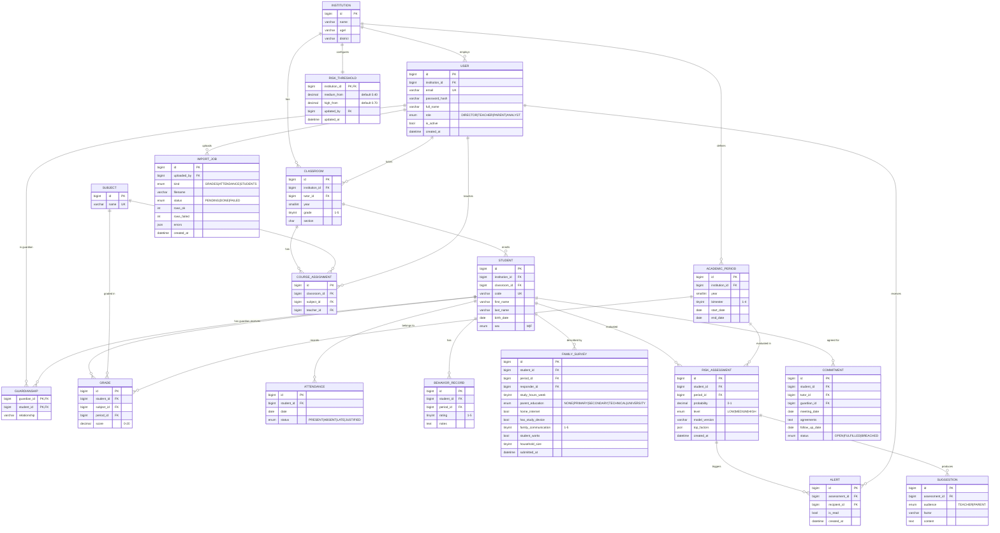

# Modelo entidad-relación

## Notas

- Las notas usan la escala vigesimal (0 a 20) para que el modelo trabaje con valores numéricos.
- Restricciones únicas:
  - `GRADE(student_id, subject_id, period_id)`
  - `ATTENDANCE(student_id, date)`
  - `RISK_ASSESSMENT(student_id, period_id, model_version)`
- Los refresh tokens se guardan en una tabla técnica `refresh_token` (hash, expiración, revocado) que se omite del diagrama.
